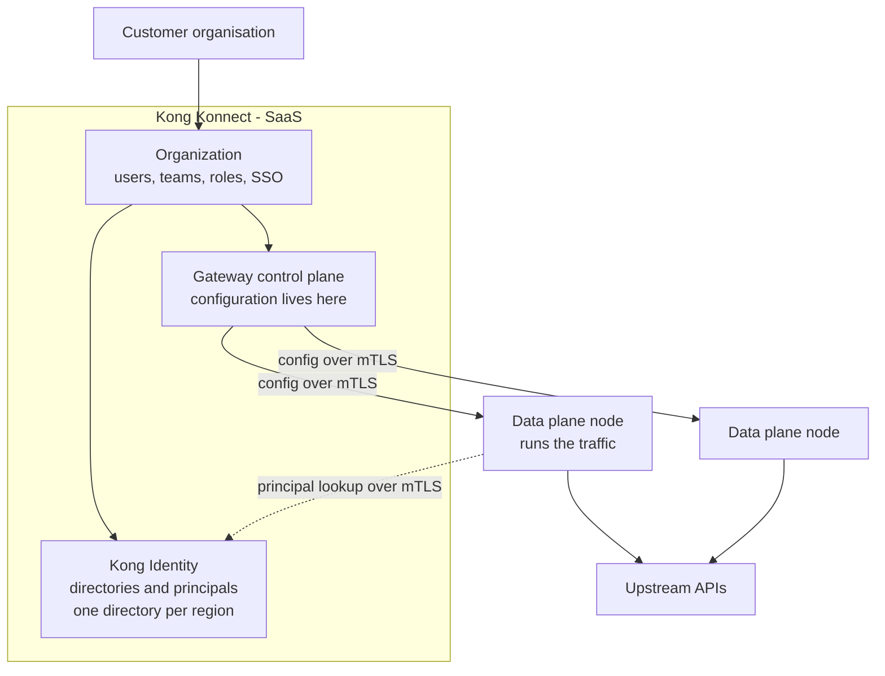
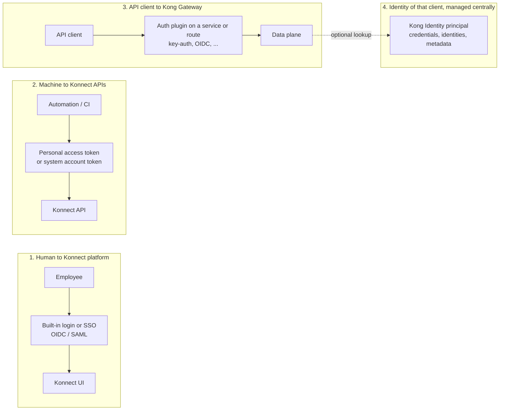
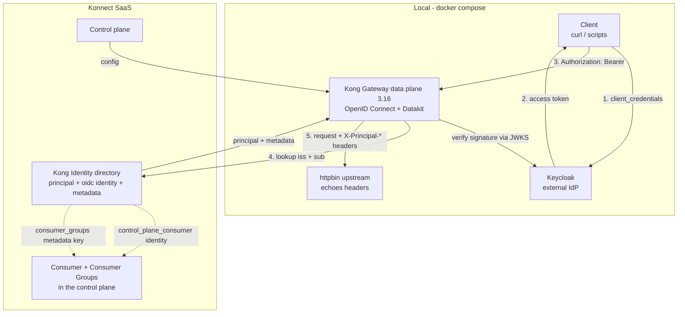
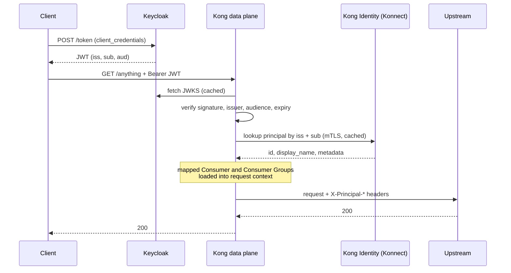
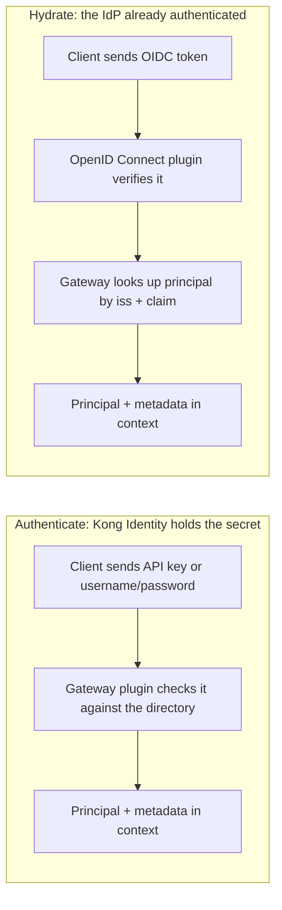
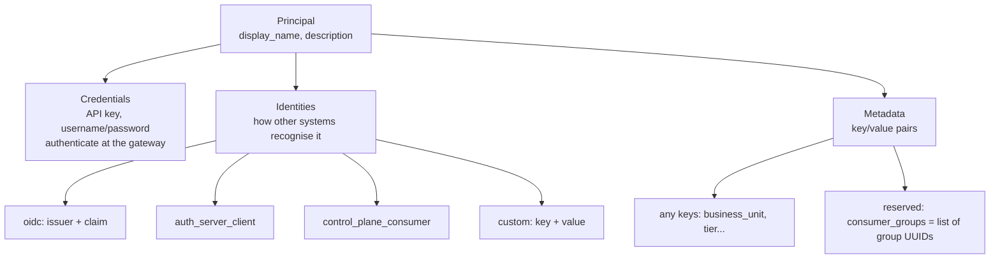

# Architecture diagrams

Mermaid source; GitHub, GitLab, VS Code and most wikis render it. The same diagrams are in the deck.
Everything marked **Konnect SaaS** runs in Kong's cloud; everything marked **local** runs in Docker on the presenter's laptop.

## 1. Konnect: who owns what

## 2. Four kinds of "who are you?" (the distinction customers confuse)

## 3. Demo architecture

## 4. Request sequence (Test C)

## 5. Authenticate vs hydrate

## 6. Principal anatomy

